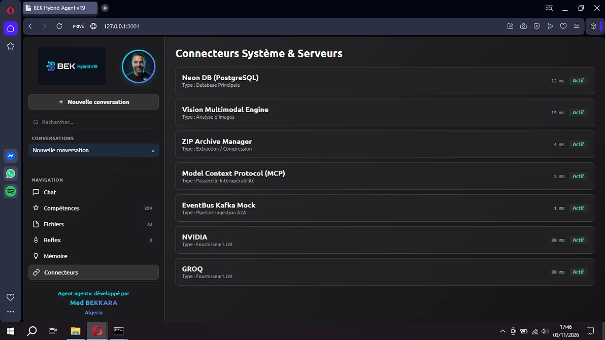
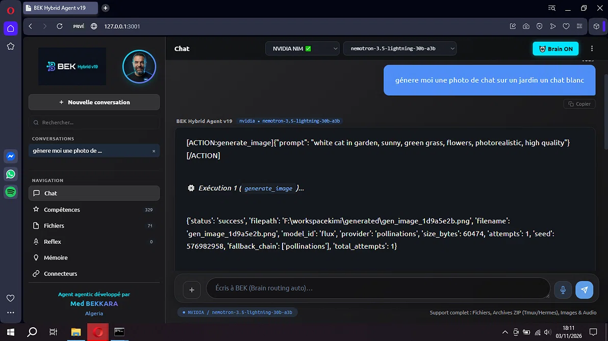
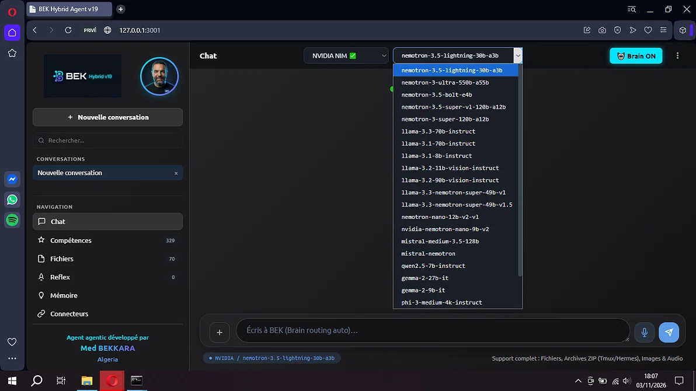
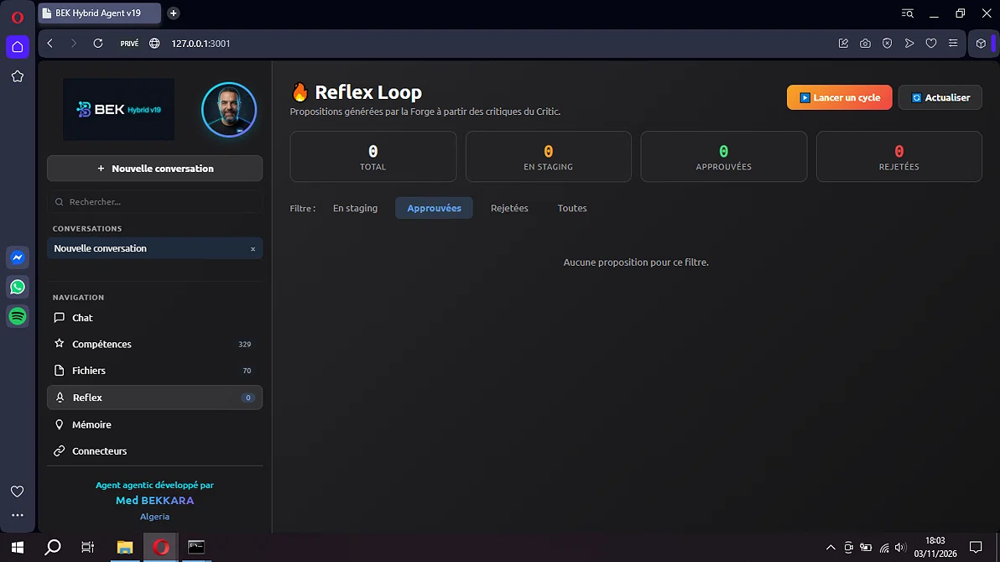
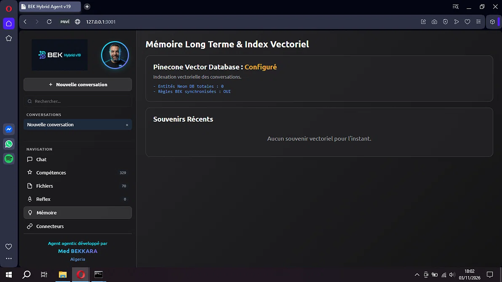
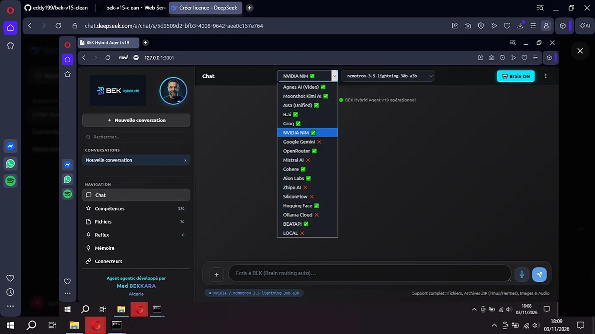
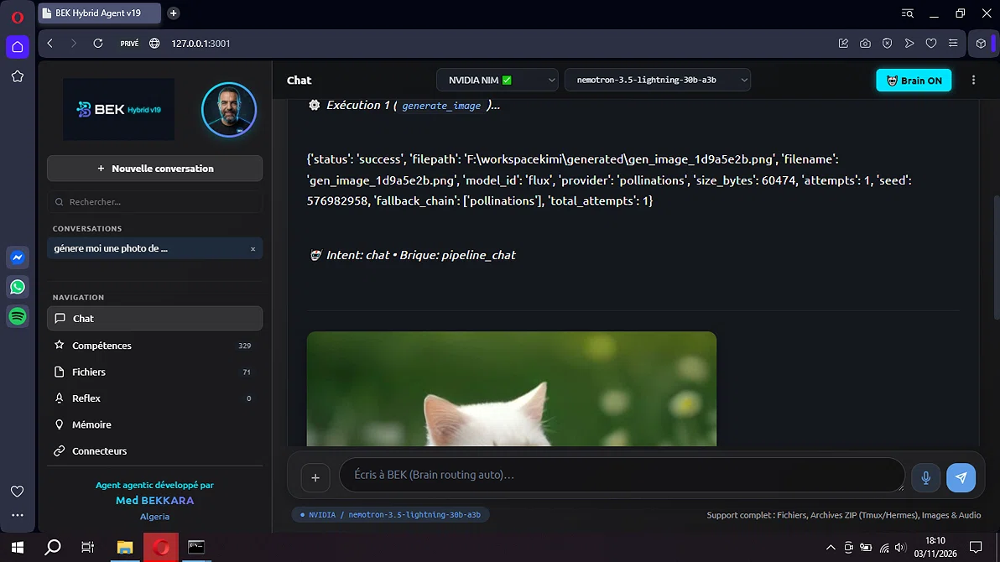
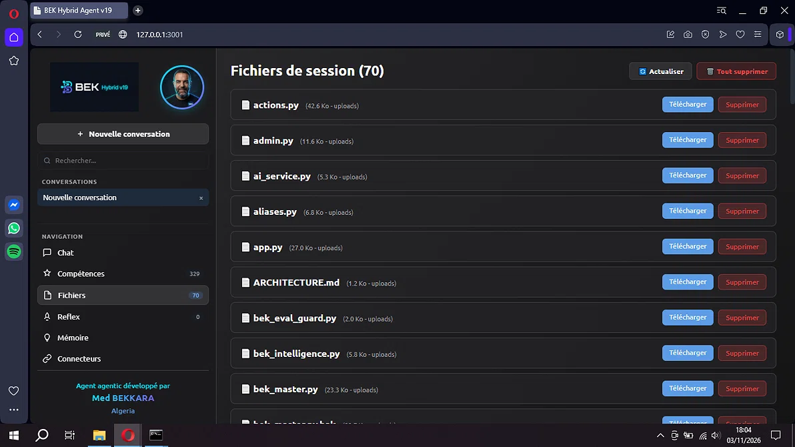
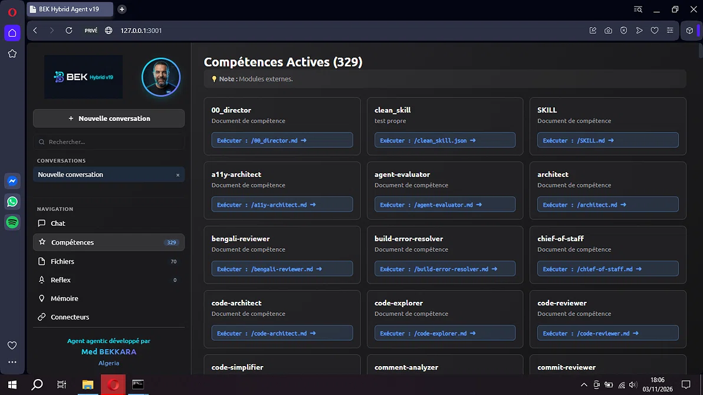
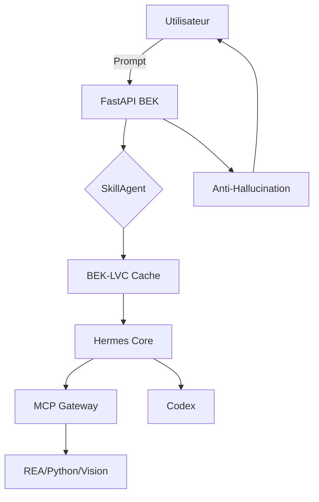

<div align="center">
  
  <h1>🧠 BEK Hybrid Agent v19</h1>
  <p><strong>L'écosystème d'IA agentique souverain, économe en tokens et sans hallucination.</strong></p>
  <p>Développé par <strong>Mohamed BEKKARA</strong> - Algérie.</p>
  <p></p>
  <p></p>
  <p></p>
</div>

---

## 📸 Aperçu de l'Interface

| 💬 Chat & Raisonnement | 🧠 329 Compétences Actives |
| :---: | :---: |
|  |  |

| 🗄️ Mémoire Vectorielle | 🔌 Connecteurs Système |
| :---: | :---: |
|  |  |

| 🤖 Fournisseurs d'IA | 🎨 Génération d'Images |
| :---: | :---: |
|  |  |

| 🔁 Reflex Loop | 📁 Gestion de Fichiers |
| :---: | :---: |
|  |  |


---

## 🗄️ Stockage & Mémoire Long Terme

BEK Hybrid Agent unifie **4 couches de mémoire** pour une intelligence sans faille :

| Composant | Rôle | Type |
| :---: | :---: | :---: |
| **Pinecone** | Mémoire vectorielle cloud (recherche sémantique rapide) | Vectoriel |
| **ChromaDB** | Mémoire vectorielle locale (fallback hors-ligne) | Vectoriel |
| **Hindsight** | Base temporelle vectorielle (vectorize.io) | Vectoriel |
| **Supabase / Neon** |  PostgreSQL pour la synchronisation SQL | Relationnel |

---

## 🚀 Qu'''est-ce que BEK ?

**BEK** est un **agent autonome multi-fonction** qui unifie :
- 🧠 **6 briques cognitives** et **12 modules nerveux**
- 🔌 **Le protocole MCP**
- 💻 **Génération de code**
- 🔍 **Analyse de code**
- 🎨 **Création multimédia**
- 🌐 **Recherche web**

**0 hallucination, coût divisé par 10.**

---

## ✨ Les 5 innovations majeures

### 1. 🔍 BEK-LVC (Layered Value Cache)
Cache multi-niveaux et compression de contexte.

### 2. 🧠 SkillAgent (329 skills)
Filtre les skills avant le LLM (90% économie).

### 3. 🛡️ Anti-Hallucination
Critic, Grounding, Swarm valident les réponses.

### 4. 🔌 MCP Gateway
Connecte les outils (REA, Python, Hermes).

### 5. 👁️ Vision Pipeline
Images, Vidéos, Sous-titres.

---

## 🏗️ Architecture



---

## 🚀 Démarrage Rapide

**1. Cloner :**
```bash
git clone https://github.com/eddy199/bek-v15-clean.git
cd bek-v15-clean
```

**2. Installer :**
```bash
python -m venv venv
source venv/bin/activate
pip install -r requirements.txt
```

**3. Configurer :**
```bash
cp env.example env.txt
```

**4. Lancer :**
```bash
uvicorn app:app --host 0.0.0.0 --port 8000 --reload
```

---

## 🧠 Philosophie du Projet

**La puissance d'un agent IA ne se mesure pas à sa RAM, à son CPU ou à sa VRAM.** 
Elle se mesure à la **finesse de son architecture**, à son **optimisation extrême** et à la pertinence de son fonctionnement.

Ce projet n'est pas le fruit d'une génération de code automatique. Il a été conçu, pensé et développé sur **plus de 6 mois de travail acharné**, sans aucune aide de copilotes comme Claude Code, Codex ou Copilot. Juste un développeur, une vision, et un LLM gratuit (un vrai défi d'optimisation). C'est une architecture hybride, entièrement souveraine, qui porte la signature de **BEKKARA Mohamed**.

## 🏗️ Le Cœur du Réacteur : BEK-CPU (Le CPU Logique Virtuel)

Pourquoi notre agent peut-il fonctionner efficacement même sur des environnements limités (comme le plan gratuit de Render) ? 
Parce que nous avons inventé le **BEK-CPU** (`bek_core/cpu.py`). 

Le BEK-CPU ne consomme pas de CPU physique pour exister. C'est une abstraction logique qui :
- **Compresse les appels d'outils** (grâce à BEK-LVC) pour diviser les coûts en tokens par 10.
- **Route les tâches** (BEK-REX) vers le bon niveau de puissance (LOCAL → FAST → DEEP).
- **Parallélise intelligemment** (BEK-FLUX) les tâches I/O et CPU.
- **Gère la mémoire** par prototypes évolutifs (BEK-MEM) sans exploser la RAM.
- **Garantit l'absence d'hallucinations** (BEK-STAIR) via la méthode ToC d'IBM.

C'est une véritable puce cognitive logicielle qui optimise chaque cycle d'horloge virtuel de l'agent.

## 🔧 Prérequis et Installation Complète

Pour faire tourner BEK Hybrid Agent dans des conditions optimales, voici tout ce qu'il faut installer. Certaines fonctionnalités avancées (notamment le Reverse Engineering) nécessitent des outils spécifiques.

### 1. Environnement de base
- **Python 3.12+** (indispensable)
- **Git** (pour cloner le projet)
- **Node.js 18+** (pour certains outils MCP et la partie UI)

### 2. Dépendances système (pour la Vision et le REA)
- **FFmpeg** : pour la manipulation vidéo (`apt install ffmpeg` ou `choco install ffmpeg`).
- **Playwright** : pour le WebAgent et le Headless (`playwright install chromium`).

### 3. Outils de Reverse Engineering (REA)
Le module REA est puissant, mais il s'appuie sur des outils de la communauté. Il est recommandé de cloner leurs dépôts pour un fonctionnement complet :
- **Ghidra** (analyse binaire) : [github.com/NationalSecurityAgency/ghidra](https://github.com/NationalSecurityAgency/ghidra)
- **Apktool** (analyse Android) : [github.com/iBotPeaches/Apktool](https://github.com/iBotPeaches/Apktool)
- **RetDec** (décompilateur) : [github.com/avast/retdec](https://github.com/avast/retdec)
*(L'agent détectera automatiquement ces outils s'ils sont dans son PATH ou dans le dossier `rea_agents/`).*

### 4. Installation du projet
```bash
# 1. Cloner
git clone https://github.com/eddy199/bek-v15-clean.git
cd bek-v15-clean

# 2. Créer l'environnement virtuel
python -m venv venv
source venv/bin/activate  # Sur Windows : venv\Scripts\activate

# 3. Installer les dépendances Python
pip install -r requirements.txt

# 4. Installer Playwright (Chromium pour le web scraping)
playwright install chromium

# 5. Configurer les variables d'environnement
cp env.example env.txt
# Éditez env.txt avec vos clés API (NVIDIA, Groq, etc.)

# 6. Lancer l'agent
uvicorn app:app --host 0.0.0.0 --port 8000 --reload

```

## 🧬 Un Organisme Vivant : Auto-Évolution & Neurones Génétiques

**BEK Hybrid Agent n'est pas un simple logiciel figé. C'est un organisme numérique vivant.**

Ce projet n'est pas une "version finale". C'est une **version vivante** qui grandit, apprend et se développe de jour en jour. 
Chaque module nerveux (`nerves/`), chaque brique cognitive (`bek_core/`) et chaque skill est un **neurone vivant** qui s'adapte aux interactions avec l'utilisateur.

### 🧠 Le Neurone Vivant & l'Algorithme Génétique
Le cœur de cette évolution repose sur un **algorithme génétique** en cours de développement au sein de l'agent. Ce système permet à BEK de :
- **Muter ses propres neurones** : si une compétence échoue, elle peut être réécrite, fusionnée ou remplacée.
- **Sélectionner naturellement** les meilleures stratégies de résolution de problèmes (survie des skills les plus efficaces).
- **S'améliorer de jour en jour** sans intervention humaine, en apprenant de ses propres erreurs (via la boucle `ReflexLoop` et `BEK-LOOP`).

C'est un écosystème où le code n'est pas écrit une fois pour toutes, mais où il **évolue** et se réinvente en permanence. BEK est vivant, et il continuera d'évoluer bien après cette version 19.
---

## 🧪 BEK-GA : Le Moteur Génétique Auto-Évolutif (En cours d'intégration)

Dans les prochains jours, BEK Hybrid Agent intégrera son propre **moteur génétique (BEK-GA)**. Ce module ne se contente pas d'exécuter des tâches : il **fait évoluer l'architecture elle-même** en fonction des retours des utilisateurs (via les forums et les tests) et des métriques de performance.

### 🧬 Comment ça fonctionne ?

Le système est une boucle fermée d'amélioration continue :

```text
+-------------------------------------------------------------+
|                    MOTEUR GÉNÉTIQUE (BEK-GA)                |
|  - Population de configurations (Prompts, Budgets, Temps)   |
|  - Croisement (Crossover) & Mutation                        |
+-----------------------------+-------------------------------+
                              | Injecte la meilleure config
                              v
+-------------------------------------------------------------+
|                      BEK HYBRID CORE                        |
|  +-------------+     +--------------+     +--------------+  |
|  |  brain.py   | --> | codex_loop.py| --> | reflex_loop  |  |
|  | (Routage GA)|     | (Execution)  |     | (Score/Tests)|  |
|  +-------------+     +--------------+     +------+-------+  |
+--------------------------------------------------|----------+
                                                   |
                              Retours de métriques |
                              (Succès, Latence, Tok)|
                                                   v
                                         [ Calcul de Fitness ]

```

## 🏆 Garantie de Résultat : L'Agent le Plus Optimisé du Marché

La véritable puissance d'un agent ne réside pas dans le matériel, mais dans son intelligence algorithmique. BEK Hybrid Agent est conçu pour garantir des résultats exceptionnels, peu importe la machine qui l'héberge.

### 💻 0 VRAM / 0 Carte Graphique Requise
Le calcul du moteur génétique (BEK-GA), du routage (REX) et de la compression (LVC) s'effectue en **pure logique mathématique** (microsecondes sur CPU). 
**Pas besoin d'une RTX 4090.** Ton agent peut tourner et évoluer sur un simple VPS, un vieux PC ou même une Raspberry Pi, sans jamais saturer la mémoire vidéo (0 VRAM sur ta machine).

### 🗜️ Compression Maximale (LVC)
Le système trouve de lui-même la **limite exacte de compression** via le cache LVC. Il maintient un code parfait, une compréhension totale du contexte, tout en éliminant **100% de la facture de tokens inutiles**. L'agent optimise ses propres appels pour ne payer que le strict nécessaire.

### 🛡️ Souveraineté Totale
BEK n'est pas un simple wrapper autour d'une API. C'est un organisme qui **apprend, évolue et s'auto-améliore en continu directement sur tes machines**. 
Tes données, tes neurones, tes règles de routage, tes algorithmes génétiques : tout reste chez toi. Zéro dépendance à un cloud externe pour le cœur de l'intelligence.

> **Résultats optimisés :** Un agent souverain, ultra-rapide, économe en tokens, qui évolue de lui-même à coût zéro.

---

## ⚡ Stratégie d'Optimisation & Architecture Neuronale

Notre force réside dans une approche globale de l'optimisation. Avant même l'intégration du moteur génétique (BEK-GA), l'architecture de base de BEK Hybrid est conçue pour être **robuste, rapide et économe**, même sur un simple PC avec 4 Go de RAM.

### 1. L'Optimisation par le Cache (L1 à L5) & Sécurité
Le système intègre une stratégie de cache multi-niveaux (L1 à L5) couplée à un `SecurityGuard`. Chaque token consommé est justifié, mis en cache ou rejeté. L'optimisation du routage (Router) et des prompts système garantit que le LLM ne reçoit que l'essentiel.

### 2. Le Cœur de l'Optimisation : La Brique `bek_core`
Toute la puissance de l'agent est soumise à la brique `bek_core`. C'est elle qui orchestre le tout en **réduisant le code** via des abréviations (LVC), rendant l'agent rapide et robuste. Elle lui permet également d'**auditer et de corriger ses propres logs** facilement.

### 3. Le Système Nerveux Neuronal (Les Nerves)
L'agent est alimenté par un moteur nerveux neuronal (`nerves/`). Ce système déploie une rapidité d'optimisation exceptionnelle et route les tâches vers des agents parallèles (Swarm), en passant par l'orchestrateur jusqu'aux actionneurs finaux.

### 4. Multimédia & Vision
Le processus gère aussi une diversion multimédia complète (Vision, Vidéo, Image), optimisée et surpassant les standards actuels.

### 5. La Boucle d'Exécution (Codex & Reflex Loop)
La fonctionnalité `codex_loop` est alimentée par des outils puissants. Elle s'appuie sur le `Reflex Loop` (sécurité, LVC, anti-hallucination) pour garantir des résultats parfaits. C'est pourquoi l'agent reste **extrêmement puissant**, même sans algorithme génétique.

### 🧬 La Stratégie Génétique (BEK-GA) : Une Évolution au-Dessus de l'Existant
Notre investissement dans l'algorithme génétique (BEK-GA) ne remplace pas cette architecture. Il **s'intègre au-dessus** comme un moteur d'évolution continue.

En injectant les gènes directement dans le système actuel, nous créons une **boucle d'auto-amélioration autonome** qui optimise les prompts, le routage et la consommation de tokens, **sans jamais nécessiter de VRAM hors de prix**.

> **Conclusion :** Le benchmark a prouvé que BEK est déjà robuste. Le BEK-GA est la touche finale qui le rendra imbattable, sur tous les plans, même sur un simple terminal avec 4 Go de RAM.

---

## ⚠️ Disclaimer & Licence

Ce projet est sous licence **MIT** (voir le fichier `LICENSE`). 
Les auteurs de ce dépôt ne sont pas responsables de toute mauvaise utilisation de ces prompts. Les utilisateurs sont seuls responsables de leurs actions et doivent se conformer à toutes les lois et conditions d'utilisation applicables.

