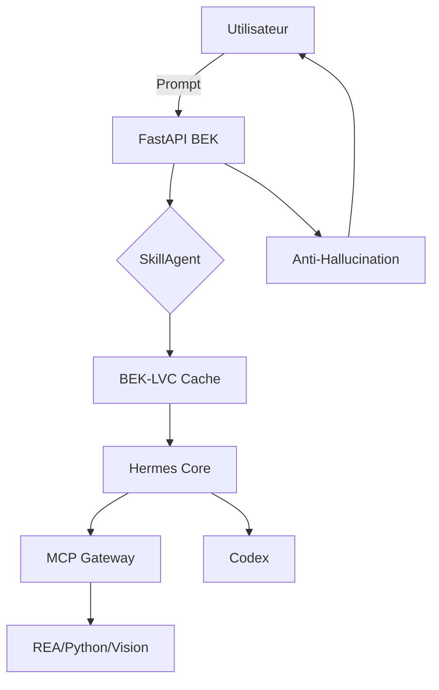

<div align="center">
  
  <h1>🧠 BEK Hybrid Agent v19</h1>
  <p><strong>L'écosystème d'IA agentique souverain, économe en tokens et sans hallucination.</strong></p>
  <p>Créé par <strong>BEKKARA Mohamed</strong> - Oran, Algérie.</p>
  <p></p>
  <p></p>
  <p></p>
</div>

---

## 📸 Aperçu de l'Interface

| 💬 Chat & Raisonnement | 🧠 329 Compétences Actives |
| :---: | :---: |
|  |  |

| 🗄️ Mémoire Vectorielle | 🔌 Connecteurs Système |
| :---: | :---: |
|  |  |

| 🤖 Fournisseurs d'IA | 🎨 Génération d'Images |
| :---: | :---: |
|  |  |

| 🔁 Reflex Loop | 📁 Gestion de Fichiers |
| :---: | :---: |
|  |  |

---

## 🚀 Qu'''est-ce que BEK ?

**BEK** est un **agent autonome multi-fonction** qui unifie :
- 🧠 **6 briques cognitives** et **12 modules nerveux**
- 🔌 **Le protocole MCP**
- 💻 **Génération de code**
- 🔍 **Analyse de code**
- 🎨 **Création multimédia**
- 🌐 **Recherche web**

**0 hallucination, coût divisé par 10.**

---

## ✨ Les 5 innovations majeures

### 1. 🔍 BEK-LVC (Layered Value Cache)
Cache multi-niveaux et compression de contexte.

### 2. 🧠 SkillAgent (329 skills)
Filtre les skills avant le LLM (90% économie).

### 3. 🛡️ Anti-Hallucination
Critic, Grounding, Swarm valident les réponses.

### 4. 🔌 MCP Gateway
Connecte les outils (REA, Python, Hermes).

### 5. 👁️ Vision Pipeline
Images, Vidéos, Sous-titres.

---

## 🏗️ Architecture



---

## 🚀 Démarrage Rapide

**1. Cloner :**
```bash
git clone https://github.com/eddy199/bek-v15-clean.git
cd bek-v15-clean
```

**2. Installer :**
```bash
python -m venv venv
source venv/bin/activate
pip install -r requirements.txt
```

**3. Configurer :**
```bash
cp env.example env.txt
```

**4. Lancer :**
```bash
uvicorn app:app --host 0.0.0.0 --port 8000 --reload
```

**5. Ouvrir :** `http://localhost:8000`
